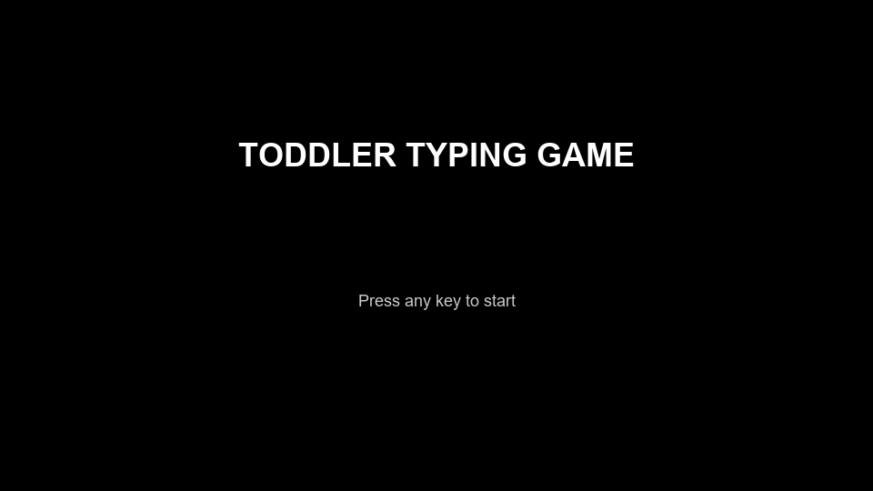
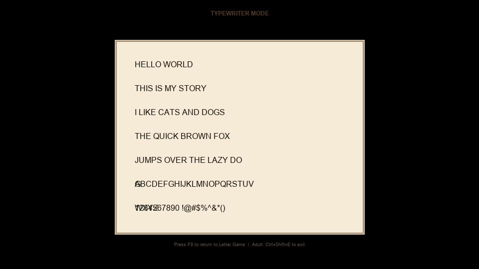
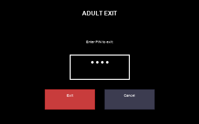

# Toddler Typing Game

A safe, fullscreen typing game for toddlers and preschoolers (ages 2-5) with a hidden "typewriter" free-play mode. Built for Windows with kiosk-mode lock-down so kids can't escape into the rest of the computer.

## ✨ Features

| Mode | Description |
|------|-------------|
| **Letter Game** | Big 300pt letters appear one at a time (A→Z shuffled). Press the matching key → cheerful sound + visual pop. Wrong key → gentle red flash + sound, stays on same letter. |
| **Free Typing (Typewriter)** | Press **F9** to toggle. Kids can type anything — letters, numbers, symbols, Enter for new lines, Backspace to erase. Realistic typewriter paper UI with scrolling, blinking cursor, and typewriter *click* and *ding* sounds. |
| **Kiosk Lock-Down** | Fullscreen borderless window. Blocks Win key, Alt+Tab, Alt+F4, Escape (gated). |
| **Auto-Start with Windows** | On first run, asks "Start automatically with Windows?" Saves preference to Registry Run key. |
| **Adult Exit (PIN-Protected)** | **Ctrl+Shift+E** (or Ctrl+Shift+Q, or Escape×3) opens a PIN dialog. Default PIN: `1234` (not shown in dialog so kids can't see it). Cancel button keeps you in the game. |

## 🖼️ Screenshots



### Letter Game — Correct Key Pressed


### Letter Game — Wrong Key (Red Flash)


### Free Typing Mode — Typewriter Paper



### Adult Exit PIN Dialog



## 🚀 Quick Start

### Download & Run (No Install)
1. Go to [Releases](https://github.com/ramgarden/ToddlerTypingGame/releases)
2. Download `ToddlerTypingGame.exe` (self-contained, ~130KB)
3. Double-click to run

### Build from Source
```bash
# Prerequisites: .NET 10 SDK
git clone https://github.com/ramgarden/ToddlerTypingGame.git
cd ToddlerTypingGame
dotnet build
dotnet run
```

### Publish Standalone EXE
```bash
dotnet publish -c Release -r win-x86 --self-contained true
# Output: bin/Release/net10.0-windows/win-x86/ToddlerTypingGame.exe
```

## 🎮 How to Play

| Action | Key |
|--------|-----|
| Start game | Any key |
| Type matching letter | A–Z keys |
| Toggle Free Typing mode | **F9** |
| Type freely (in Typewriter mode) | Any printable key |
| New line (Typewriter) | **Enter** |
| Delete (Typewriter) | **Backspace** |
| Exit to adult menu | **Ctrl+Shift+E** (or Ctrl+Shift+Q, or Escape×3) |
| Enter PIN in dialog | Type `1234` + Enter |
| Cancel exit dialog | Click "Cancel" or press Esc |

## 🔧 Configuration

### Change Adult PIN
The PIN is hardcoded as `1234` in `Form1.cs` (`AdultExitDialog.DefaultPin`). To change it, edit and rebuild:
```csharp
private const string DefaultPin = "YOUR_NEW_PIN";
```

### Disable Auto-Start
1. Run the game once and choose "No" on the first-run prompt, **OR**
2. Delete the registry value:
   ```reg
   HKEY_CURRENT_USER\Software\Microsoft\Windows\CurrentVersion\Run\ToddlerTypingGame
   ```

### Settings Location
User preferences stored in:
```
%APPDATA%\ToddlerTypingGame\settings.json
```

## 🛡️ Safety & Kiosk Details

- **No window chrome** — No title bar, no minimize/maximize/close buttons
- **Keyboard hook** (WH_KEYBOARD_LL) intercepts system hotkeys before Windows sees them
- **TopMost = true** — Stays above all other windows
- **Cursor hidden** — No mouse distraction
- **Exit always available** — Three independent triggers, all PIN-gated:
  1. `Ctrl+Shift+E`
  2. `Ctrl+Shift+Q`
  3. `Escape` pressed 3× within 1 second
- **Fallback** — If all else fails: `Ctrl+Alt+Del` → Task Manager → End task

## 📁 Project Structure

```
ToddlerTypingGame/
├── Program.cs              # Entry point, first-run prompt, registry auto-start
├── Form1.cs                # Main form: kiosk, keyboard hook, both game modes, adult exit
├── Form1.Designer.cs       # Auto-generated WinForms designer code
├── ToddlerTypingGame.csproj
├── agents.md               # Full technical handoff for AI agents
├── .gitignore
└── README.md               # This file
```

## 🧩 Technical Stack

- **.NET 10** (net10.0-windows)
- **Windows Forms** for native Windows UI
- **P/Invoke** for low-level keyboard hook (`SetWindowsHookEx`, `WH_KEYBOARD_LL`)
- **System.Media.SystemSounds** for built-in beep/asterisk/hand sounds
- **JSON** settings in `%APPDATA%`
- **Registry** Run key for auto-start

## 📄 License

MIT License — Free to use, modify, and distribute.

---

**Built for my toddler. Hope your little one enjoys it too!** 🎉